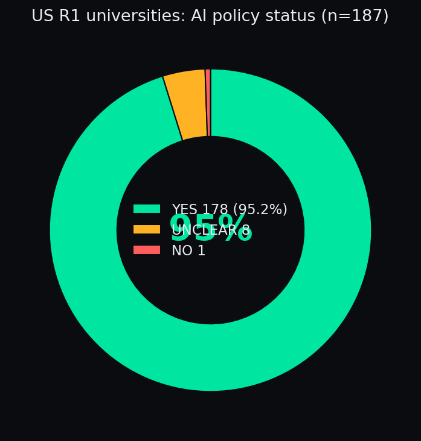

# US Carnegie R1 AI Policy Audit 2026

> **Atlanta College of Liberal Arts and Sciences (ACLAS)** — published as part of [Study Intelligence](https://aclas.si), the university's open research program · [aclas.college](https://aclas.college)


An open dataset of **all 187 US Carnegie R1 research universities** (2025
Carnegie Classification), audited for whether each publishes official AI usage
guidance/policy on its own domain.


> **Also on Kaggle:** [aclascollege/us-r1-ai-policy-audit-2026](https://www.kaggle.com/datasets/aclascollege/us-r1-ai-policy-audit-2026) — download the CSV without git, or fork it straight into a notebook.

## In plain English

**What is this?** A checklist for every single one of America's 187 top
research universities (the "R1" list): *does it publish official rules for
using AI?* We opened each school's own website to check.

**The answer in one picture:**



95% say yes. Exactly **one** school (University of Wyoming) confirmed it has
no policy. The US research sector hasn't banned AI — it has *standardized*
on governing it.

## Try it (30 seconds)

```python
import pandas as pd
df = pd.read_csv("us-r1-ai-policy-audit-2026.csv")
print(df["has_policy"].value_counts())
# find your school:
print(df[df["university"].str.contains("Harvard")][["university","has_policy","policy_url"]])
```

## FAQ

**Why should I care?** If you study or teach at a US research university,
there's a 95% chance your school already has AI rules — most students just
don't know where they are. This tells you exactly where.

**What does UNCLEAR mean?** We couldn't verify — usually dead links or
login-walled pages. It does *not* mean the school has no policy.

**How fresh is this?** Snapshot 2026-10-17. AI policies change fast; open
the `policy_url` before quoting a row.

## Headline numbers

- **178 of 187 (95.2%)** publish verifiable AI usage guidance — the US research
  sector has effectively standardized on governing AI, not banning it.
- **1 confirmed NO:** University of Wyoming (no adopted policy; only a 2023
  working-group draft).
- **8 UNCLEAR** (could not verify — not proven absent): Brown, Clemson,
  UT Health San Antonio, UT Southwestern, UMass-Boston, Miami, UNH,
  Weill Cornell Medicine. Reasons per row in `note`.

## Files

| File | Description |
|---|---|
| `us-r1-ai-policy-audit-2026.csv` / `.json` | 187 rows, one per R1 university |
| `METHODOLOGY.md` | Definitions, verification rules, caveats |
| `AUDIT-LOG.md` | List source, corrections, least-sure rows |
| `raw/` | The 16 audited batch tables + 2 fix files (provenance) |
| `parse.py` | Exact script that generated CSV/JSON from raw tables |

## Columns

`id`, `university`, `official_domain`, `has_policy` (`YES`/`NO`/`UNCLEAR`),
`policy_url` (opened and confirmed live on 2026-10-17), `page_title`,
`date_info`, `scope` (students / faculty-teaching / all-community…),
`note`.

## Notes

- Snapshot date: **2026-10-17**. Policies change; verify before citing a row.
- Cross-dataset note: **Brown University** is `UNCLEAR` here but `YES` in the companion
  `ai-policy-audit-2026` (2026-10-14) — this audit applied a stricter
  university-wide-policy-only rule (a committee report + syllabus examples do not count
  as an institution-level policy). The stricter rule is the current standard.
- ~30 rows are "soft YES" (guidance-level vs formal policy, crawl-only
  confirmation, draft-labeled PDFs) — flagged in `AUDIT-LOG.md`. A wrong YES
  is worse than an UNCLEAR; treat soft YESes accordingly.
- Corrections welcome via issues/PRs.

## License

[CC-BY-4.0](LICENSE) — cite "Atlanta College of Liberal Arts and Sciences (ACLAS) — Study Intelligence (aclas.si)".

---
Published by the **Atlanta College of Liberal Arts and Sciences (ACLAS)** as part of [Study Intelligence](https://aclas.si), an open research program on AI and higher education.
